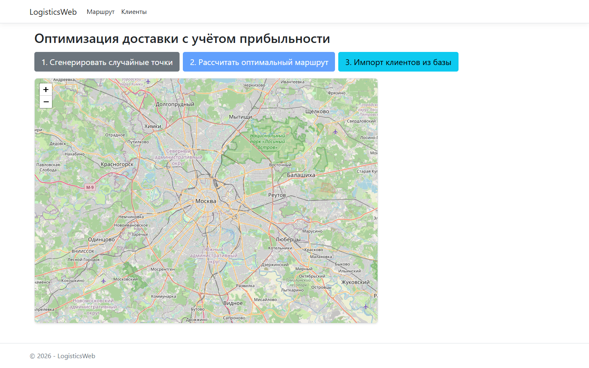
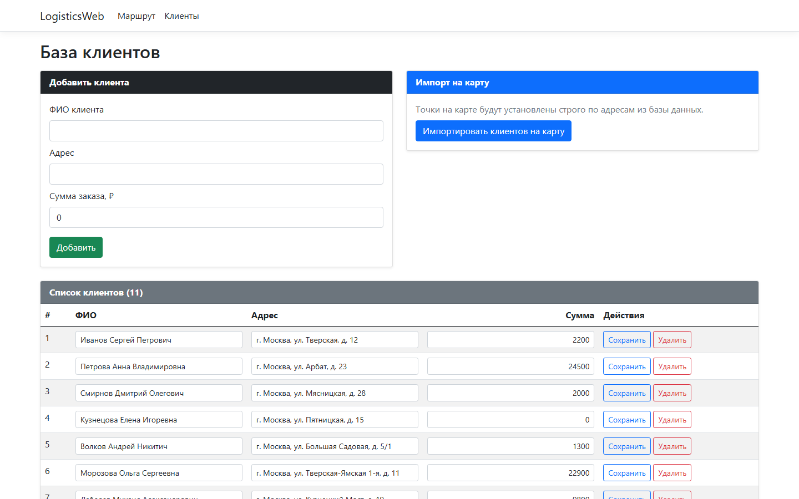

<div align="center">

# LogisticsWeb

**Планирование доставки, которое считает не километры, а деньги**

[](https://dotnet.microsoft.com/)
[](https://learn.microsoft.com/aspnet/core/razor-pages/)
[](https://learn.microsoft.com/dotnet/csharp/)
[](https://leafletjs.com/)
[](https://project-osrm.org/)
[-blueviolet)](#о-проекте)

Веб-приложение на ASP.NET Core 8: база клиентов, интерактивная карта и поиск **самого прибыльного** маршрута доставки, а не просто самого короткого.

</div>

---

## О проекте

Курьеру или небольшой службе доставки нужно не «проехать меньше всего», а **заработать больше всего**. Короткий маршрут может вести мимо дешёвых заказов, а длинный — к дорогим. LogisticsWeb решает именно эту задачу: для набора точек с суммами заказов программа ищет вариант поездки с максимальной чистой прибылью и **отбрасывает заказы, которые не окупают дорогу**.

Проект разработан как **учебный проект в вузе** — это самостоятельная работа по веб-разработке и алгоритмам, выполненная целиком «с нуля»: от модели данных и хранилища до расчётного модуля и интерфейса с картой.

> **Главная идея:** маршрут оптимизируется по деньгам. Каждый километр стоит 900 ₽, у каждой остановки есть доход, и лучший маршрут — тот, где `доход − пробег × 900 ₽/км` максимален.

## Возможности

| Возможность | Описание |
|---|---|
| **База клиентов** | CRUD-таблица на Razor Pages: ФИО, адрес, координаты, сумма заказа. Хранение в JSON-файле без внешней СУБД |
| **Подсказки адресов** | Автодополнение из встроенного справочника адресов Москвы с координатами (`AddressBook`) |
| **Интерактивная карта** | Leaflet + OpenStreetMap: точки клиентов, склад, линии маршрута со стрелками направления |
| **Оптимизация по прибыли** | Перебор комбинаций остановок (DFS) + поиск кратчайших участков (Дейкстра) по матрице дорожных расстояний |
| **Реальные дорожные расстояния** | Матрица расстояний из публичного OSRM API; при недоступности — хаверсин × 1.25 |
| **Финансовая детализация** | Доход, пробег, расходы и чистая прибыль — по каждому участку и итогом по маршруту |
| **Отбраковка убыточных точек** | Остановки, которые не окупают дорогу, в маршрут не попадают и подсвечиваются на карте красным |
| **Демо-режим** | Кнопка генерации случайных точек по реальным адресам Москвы — попробовать без ввода данных |

## Скриншоты

<div align="center">

**Маршрут и карта**



**База клиентов**



</div>

## Как это работает

```
 ┌──────────────────┐     ┌───────────────────┐     ┌────────────────────┐
 │  База клиентов   │     │  Набор точек      │     │  Матрица расстояний│
 │ App_Data/        │ ──► │ склад + клиенты   │ ──► │ OSRM (fallback:    │
 │ clients.json     │     │ (Session)         │     │ хаверсин × 1.25)   │
 └──────────────────┘     └───────────────────┘     └─────────┬──────────┘
                                                             │
                        ┌────────────────────────────────────┘
                        ▼
        ┌──────────────────────────────────────────┐
        │ Поиск самой выгодной комбинации          │
        │ • DFS по всем подмножествам остановок    │
        │ • Дейкстра для расстояний участков       │
        │ • критерий: доход − пробег × 900 ₽/км    │
        └──────────────────┬───────────────────────┘
                           ▼
        ┌──────────────────────────────────────────┐
        │ Карта (Leaflet + OSRM-трек) и таблица    │
        │ финансов по каждому этапу маршрута       │
        └──────────────────────────────────────────┘
```

**Формула прибыли маршрута:**

```
profit(route) = Σ доход заказов по остановкам − (пробег, км × 900 ₽)
```

Поскольку заказ добавляет доход и одновременно увеличивает пробег, вопрос «стоит ли ехать к этому клиенту» решается только числом: если прирост расходов больше суммы заказа, точка не попадает в маршрут.

Подробно об алгоритме, структуре данных и ограничениях — в [docs/ARCHITECTURE.md](docs/ARCHITECTURE.md).

## Технологии

| Слой | Технологии |
|---|---|
| Backend | C# 12, .NET 8, ASP.NET Core **Razor Pages**, Session state |
| Хранение | JSON-файл `App_Data/clients.json` через `IClientRepository` (интерфейс готов под замену на БД) |
| Фронтенд | Bootstrap 5, jQuery, Leaflet 1.9, leaflet-polylinedecorator |
| Геоданные | OSRM public routing API, тайлы OpenStreetMap, встроенный справочник адресов Москвы |
| Алгоритмы | DFS по комбинациям остановок, алгоритм Дейкстры, формула хаверсина |

## Структура репозитория

```
Logistic-web/
├── Data/
│   └── ClientRepository.cs      # IClientRepository + JSON-хранилище
├── Models/
│   ├── Client.cs                # клиент: ФИО, адрес, координаты, сумма
│   └── AddressBook.cs           # справочник адресов Москвы с координатами
├── Pages/
│   ├── Index.cshtml(.cs)        # карта, расчёт маршрута, финансовая таблица
│   ├── Clients.cshtml(.cs)      # CRUD базы клиентов, автодополнение адресов
│   └── Shared/_Layout.cshtml    # общий макет
├── wwwroot/                     # статика (css, js, lib)
├── App_Data/clients.json        # данные клиентов (демо-набор)
├── docs/                        # документация и скриншоты
├── Program.cs                   # DI, сессии, middleware
└── LogisticsWeb.csproj          # net8.0
```

## Быстрый старт

**Требования:** [.NET 8 SDK](https://dotnet.microsoft.com/download/dotnet/8.0) (Windows, Linux или macOS) и доступ в интернет для карты и OSRM.

```bash
git clone https://github.com/vlad200zel/Logistic-web.git
cd Logistic-web
dotnet run
```

Откройте **http://localhost:5085**

Профиль HTTPS: `dotnet run --launch-profile https` → https://localhost:7237

Ни базы данных, ни API-ключей, ни авторизации не требуется: приложение поднимается «из коробки».

## Документация

| Документ | О чём |
|---|---|
| [docs/USER-GUIDE.md](docs/USER-GUIDE.md) | Пошаговая инструкция: как добавить клиентов, построить маршрут и читать результат |
| [docs/ARCHITECTURE.md](docs/ARCHITECTURE.md) | Архитектура, поток данных, алгоритм поиска маршрута, сложность, ограничения |
| [docs/DEVELOPMENT.md](docs/DEVELOPMENT.md) | Настройка окружения, сборка, структура кода, как расширять проект |

## Ограничения

Проект учебный, и это честно зафиксировано в коде и документации:

- **Полный перебор** комбинаций остановок — быстро для 5–10 точек, неприемлемо для сотен (факториальная сложность);
- **Публичный OSRM** — бесплатный демо-сервер: возможны задержки и лимиты, поэтому есть fallback на хаверсин;
- **Данные в JSON-файле и в сессии** — нет многопользовательской работы и сохранности при перезапуске сессии;
- **Нет авторизации** — приложение рассчитано на локальный запуск.

## Планы развития

- [ ] Заменить JSON-хранилище на EF Core + SQLite/PostgreSQL
- [ ] Вынести расчёт в сервис и добавить ограничения (время смены, грузоподъёмность, число машин)
- [ ] Заменить полный перебор на 2-opt / OR-Tools для наборов больше 10 точек
- [ ] Кэшировать матрицу расстояний и запросы к OSRM
- [ ] Покрыть расчётный модуль unit-тестами

---

## English

**LogisticsWeb** is an ASP.NET Core 8 (Razor Pages) web application for delivery planning that optimises routes **by profit, not by distance**.

- **Client database** (CRUD) stored in a JSON file: name, address, coordinates, order amount.
- **Address autocomplete** from a built-in Moscow address book with lat/lon.
- **Interactive map** (Leaflet + OpenStreetMap) with client markers and a route polyline with direction arrows.
- **Profit-aware route search**: every combination of stops is evaluated and the most profitable one is kept, where `profit = Σ order amounts − distance(km) × 900 ₽`. Stops that do not pay for their detour are dropped and highlighted in red.
- **Real road distances** from the public OSRM API, with haversine × 1.25 as a fallback.
- **Cost breakdown** per leg and in total: revenue, mileage, travel cost, net profit.

**Run it:**

```bash
git clone https://github.com/vlad200zel/Logistic-web.git
cd Logistic-web
dotnet run            # http://localhost:5085
```

Requires .NET 8 SDK only — no database, no API keys, no authentication.

**Status:** a university coursework project, kept as a portfolio piece. The route search is a brute-force DFS over stop combinations — good enough for ~10 stops, intentionally not production-grade. See [docs/ARCHITECTURE.md](docs/ARCHITECTURE.md) for the algorithm and its limits.

---

<div align="center">

**Автор:** Владислав Зеленков · [@vlad200zel](https://github.com/vlad200zel)

Учебный проект · ASP.NET Core 8 · 2026

</div>
